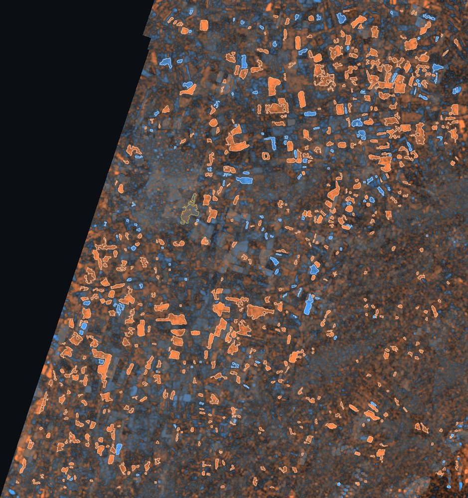

# Between Passes

**Can a radar satellite tell, from space, whether farmland got wetter or drier?**

NASA and ISRO's new **NISAR** satellite sees the ground through cloud and darkness, passing over the same place every 12 days. I used it to answer one question about my home region in southern Türkiye, then tested the answer at random places around the world.

**[Open the live app →](https://deniz2077.github.io/between-passes/)**   ·   [Worldwide test](https://deniz2077.github.io/between-passes/world.html)   ·   [7-slide demo](https://deniz2077.github.io/between-passes/demo/Between_Passes_NASA_demo.pdf)   ·   [Türkçe](https://deniz2077.github.io/between-passes/tr.html)

*NASA Space Apps Challenge 2026 · Dancing with the SARs · Team Dusk Orbit (Deniz Efe Bulut) · Niğde Local Event*

---

## What I found

**1. Something changed.** Between two passes, on 22 October and 3 November 2026, seven times more farmland around Ceyhan lit up on radar than went dark. The town centre, which should not change, stayed the same. So the change is real.

**2. Most likely, wet soil.** I checked three more NASA datasets. An optical satellite shows most of those fields kept their plants, so it wasn't mainly the harvest. The first big autumn rain fell between the passes. And NASA's soil-moisture satellite saw the soil there more than double in water.

**3. It holds around the world.** I picked 200 random places NISAR had seen twice, and wrote the rules of the test down before looking at any data. At the places with good soil data, when the soil got wetter or drier, the radar usually changed with it. Then I repeated the whole test on 200 new places. Same answer.

**4. The next pass will check it.** NISAR flew over Ceyhan again on 15 November. The day before, I published what that pass should show: as the soil dries, the bright fields dim again. NASA releases the data about 10 to 20 days after a pass. The result will appear on the live app, scored by code that was saved before the satellite flew.

## What you can do in the app

- Swipe between the two passes.
- Tap any field to see what changed and why.
- Draw your own field and measure it.
- Explore every site of the worldwide test.
- Read a plain-language summary in Turkish, for local farmers.

Every number is checked again in your browser each time the page opens.

## The data

All from NASA, all public:

| Dataset | What it tells us |
|---|---|
| **NISAR** radar (NASA and ISRO) | What changed on the ground |
| **SMAP** soil moisture | Whether the soil got wetter or drier |
| **HLS** optical imagery | Whether plants were removed |
| **POWER** weather | When it rained |

## Go deeper

| | |
|---|---|
| [How it works](docs/METHOD.md) | Every step, in detail |
| [What I don't claim](docs/LIMITATIONS.md) | The honest limits |
| [The worldwide test](research/global/RESULTS.md) | Results, written before and after |
| [The prediction](research/prediction/PREDICTION.md) | Locked on 14 Nov, before the pass |
| [Reproduce it](docs/REPRODUCE.md) | Run everything yourself |
| [Data sources](DATA_PROVENANCE.md) | Exact files and credits |
| [Sprint reports](sprint-reports/) | How the two days went |

## AI use

AI assisted with software development, data-processing code and documentation. The research question, study area and project decisions were made by me. All numbers are computed from NASA data by the code in this repository and are re-verified by tests and in the browser. No AI-generated imagery is used.

Full details: [docs/AI_USE.md](docs/AI_USE.md).

---

Code: MIT license. Data remain under their providers' terms. Map context © OpenStreetMap contributors. Not an official NASA or ISRO product.
