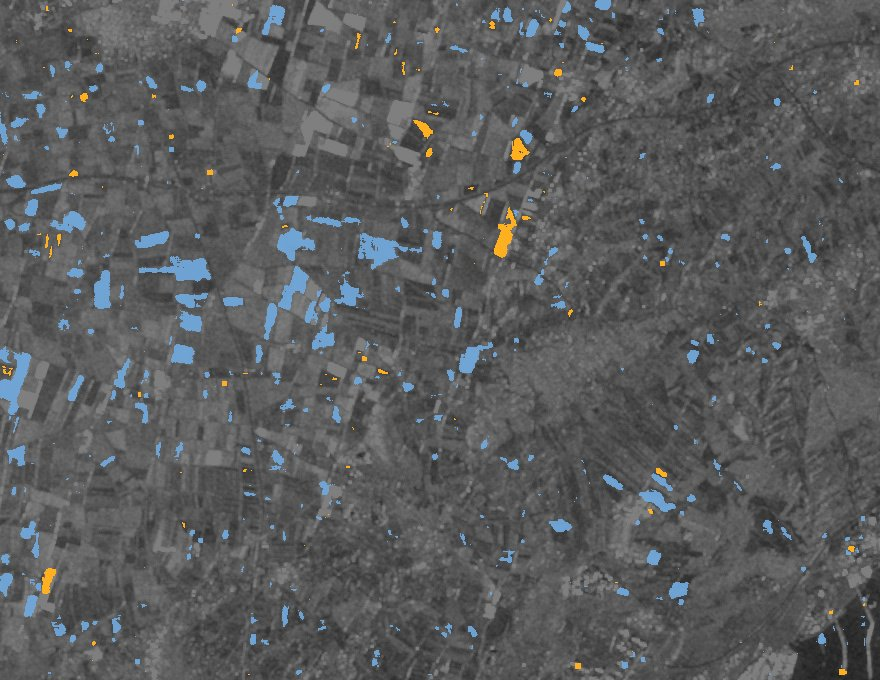

# Between Passes

**Rain fools radar. Between Passes shows what really changed.**

Satellites find floods, harvests and cut-down forests by comparing two pictures of the same place. But rain fools them: wet ground looks different, so after a rainy week whole regions look "changed" when nothing happened. Between Passes is a filter that sorts out those false alarms, so people see only the real changes.

**Who it's for:** anyone who uses satellite change maps. Disaster teams looking for floods, agencies watching farms and forests, farmers checking their fields.

**[Open the live app →](https://deniz2077.github.io/between-passes/)**   ·   [Ceyhan lab](https://deniz2077.github.io/between-passes/lab.html)   ·   [Worldwide test](https://deniz2077.github.io/between-passes/world.html)   ·   [7-slide demo](https://deniz2077.github.io/between-passes/demo/Between_Passes_NASA_demo.pdf)   ·   [Türkçe](https://deniz2077.github.io/between-passes/tr.html)



*Blue: could be just the rain. Orange: something really changed. Real NASA-ISRO NISAR radar, 3 Nov 2026.*

*NASA Space Apps Challenge 2026 · Dancing with the SARs · Team Dusk Orbit (Deniz Efe Bulut) · Niğde Local Event*

---

## The problem, measured
At 147 random places NISAR passed over twice, **28 times more land looked "changed"** where the soil got wetter or drier than where it stayed the same (5.0% of the land against 0.18%, typical place; soil wetness from NASA's SMAP satellite). Where the soil got wetter or drier, **85%** of that "change" could be just the weather.

## How the filter works
1. **Measure.** Two NISAR passes, 12 days apart, from the identical orbit. Everything that changed strongly (the radar echo doubled or halved) is flagged.
2. **Ask the weather.** NASA SMAP measures how wet the soil was on both days; NASA POWER gives the rain in between.
3. **Sort.** Wetter soil can only make radar brighter, drier soil only darker. A change that matches the weather *could be just the rain*. A change that goes against it can't be: **something really changed there**.

The rules were [committed before running them on any place](research/filter/WEATHER_FILTER.md).

## What it found
- **148 places, 39 countries.** 41 show something really changed, 27 are mostly just the weather, 80 are quiet. Every place has its own card: drag between the two passes, switch the filter on, share the link.
- **Ceyhan, my home region.** The first autumn rain fell between the passes and SMAP saw the soil more than double in water. 508 fields got brighter (could be the weather; an optical satellite shows only 9% lost their plants). 128 fields got darker, which wetter soil can't do. The app lists them, largest first, with the nearest village: **where to look first**.
- **The physics is tested.** With the rules written before looking at any data, NISAR's change followed SMAP's soil-moisture change at 74 random places, and again at 73 new ones. Both times the link was strong and very unlikely to be luck (less than a 1-in-1,000 chance; Spearman ρ = 0.58 and 0.55).

## The proof: predictions made before the data existed
If Ceyhan's bright fields were wet soil, they will fade as it dries; if ploughed, they will stay bright. I published what three upcoming NISAR passes will show, **before NASA released any of that data**. The app scores them automatically as the data arrive, whatever the result.

## Run it on any place
```bash
python scripts/bp_check.py --lat 38.50 --lon -98.50 --name "Kansas, USA"
```
Finds two NISAR passes over the point, reads only the needed part of each file, asks SMAP and POWER about the weather, and writes the filtered change map and a report. Needs a free NASA Earthdata account ([setup](docs/REPRODUCE.md)).

## The data
| NASA dataset | Role |
|---|---|
| **NISAR** L2 GCOV radar (NASA–ISRO) | What changed on the ground |
| **SMAP** soil moisture | Whether the soil got wetter or drier |
| **POWER** weather | How much it rained in between |
| **HLS** optical imagery | Whether plants were removed (Ceyhan) |

## Go deeper
| | |
|---|---|
| [The filter's rules](research/filter/WEATHER_FILTER.md) | Fixed before computing · [results](research/filter/results.json) |
| [How it works](docs/METHOD.md) | Every step in detail |
| [What I don't claim](docs/LIMITATIONS.md) | The honest limits |
| [The worldwide test](research/global/RESULTS.md) | Rules written first, repeated |
| [The predictions](research/prediction/PREDICTION2.md) | Locked before NASA released the data ([first one](research/prediction/PREDICTION.md)) |
| [Reproduce it](docs/REPRODUCE.md) | Run everything yourself |
| [Data sources](DATA_PROVENANCE.md) | Exact files and credits |
| [Sprint reports](sprint-reports/) | How the two days went |

## AI use
The project idea, research question, study area and every key decision are mine. AI (Claude Code) did the coding, data analysis and document drafting, and proposed the statistical tests, the prediction framework and the weather-filter framing, which I evaluated and adopted. All numbers are computed from NASA data by the code in this repository and checked by tests and in the browser. No AI-generated imagery. Details: [docs/AI_USE.md](docs/AI_USE.md).

---

Code: MIT license. Data remain under their providers' terms. Map context © OpenStreetMap contributors; land and country outlines from Natural Earth. Not an official NASA or ISRO product.
